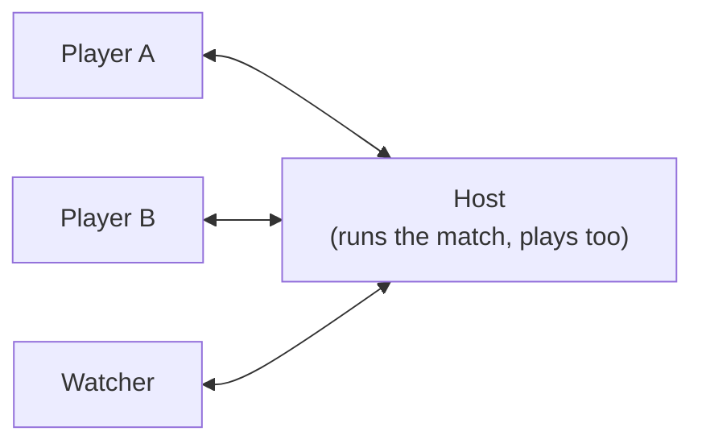

# How Padel works

This covers how the pieces fit together: the code's layout, one tick and one frame, the match (the
ball, the rules, serving, shots, scoring, the bots), the network, who decides what, and the drawing.
For the game as a player sees it, read the README. For how to change things, read
[making-changes.md](making-changes.md).

## The code

| | | |
|---|---|---|
| `src/sim/constants.ts` | sim | The court's sizes, the ball's bounces, and every number that sets the feel: speeds, reach, charge and serve times, the dive |
| `src/sim/types.ts` | sim | The shapes: `TickInput`, `Player`, `Ball`, `State`, and the `View` sent over the network |
| `src/sim/court.ts` | sim | `moveBall`: the ball against the floor, the net and the walls, as events. `hittableDistance`: may this player hit it now. The side helpers `halfSign`, `fwd`, `rightX` |
| `src/sim/body.ts` | sim | `moveBody`: running, standing still while charging, the dive. Run by the host and by each player's own screen |
| `src/sim/aim.ts` | sim | Where shots go: `shotKind`, `shotTarget` and the depths; the serve's box. Also draws the player's target |
| `src/sim/sim.ts` | sim | `newMatch`, `step`, `toView`: the rules, serving, swings and shots, scoring, the stats, `FORMATS`, `EMOTES` |
| `src/sim/bot.ts` | sim | The bots: where the ball will go, who takes it, where to stand, when to charge, where to aim; `LEVELS` |
| `src/sim/controls.ts` | sim | `Controls`, the keys as they travel; `edges`, which turns them into one tick's input; `cleanControls` |
| `src/sim/rng.ts` | sim | The seeded random numbers |
| `src/session.ts` | browser | Rooms over PeerJS: `HostSession` (runs the match) and `ClientSession` |
| `src/predict.ts` | browser | `Me`: a friend's own figure, moved at once on their screen |
| `src/main.ts` | browser | The screens, the frame loop, the player's overlay, and the glue between all of it |
| `src/render.ts` | browser | The court in perspective on a canvas, the players, the ball, the HUD |
| `src/input.ts` | browser | The keyboard: held keys, plus presses counted |
| `src/audio.ts` | browser | Every sound, synthesized with Web Audio |

The **sim** files never touch the DOM, so `node --test` can load them. The tests in
`test/sim.test.ts` play serves, shots and whole bot matches with them.

## One tick, on the host

`HostSession.tick` runs from a worker timer, so a host tab in the background keeps playing. It
catches up in fixed steps of `DT = 1/60` s (at most 0.25 s at a time). Each step builds every
player's `TickInput` with `edges` (the host's own keys, and each friend's latest `Controls`) and
calls `step(s, inputs)`:

1. The phase timer and the time since the last hit go up.
2. `botInputs(s)` decides every bot's keys.
3. `control()` for each player:
   - counts down the cooldown, the swing and an emote, and starts a new emote;
   - reads the aim (`aim`, the arrows);
   - moves them with `moveBody`, or, for a friend, puts them where they say they are (see
     [Where a friend is](#where-a-friend-is));
   - then `serveControl` for the server waiting to serve, `swingControl` for everyone else.
4. Before the serve, `holdBall` keeps the ball in the server's hand.
5. In a rally (and after it, while the ball dies), `moveBall` runs in 4 substeps. Each event it
   reports (floor, wall, net, cord, out, crossing) bumps a sound counter, and in a rally goes to
   `rule()`.
6. In a rally, `tryHit` for each player.
7. 1.8 s after a point (`POINT_PAUSE`), `finishPoint` scores it and sets up the next serve.

Every second step, `toView` makes the `View` and it goes to every friend: 30 a second.

## One frame, in a browser

`frame()` in `main.ts`, every animation frame:

- **The host** draws `toView(session.state)` straight from the match.
- **A friend** reads the newest view, moves their own figure with `Me.update`, sends their keys and
  position (`sendControls`), then draws the smoothed view with their own figure put where `Me`
  says.
- `overlay()` works out what only the player sees: their charge, where the shot would go, and
  whether the ball is in their reach.
- `renderer.draw` draws it all, `playEvents` plays the counters that went up, and the end screen
  appears when the phase is `over`.
- With no match on (the home and lobby screens), it steps a match of four bots itself and draws
  that, blurred, behind the panels.

## The match

### The ball

`moveBall` (`court.ts`) moves the ball by gravity and reports what it touched, without judging:

- **The net.** Crossing below the tape (`NET_H − CORD`) it bounces back, slowed. Within `CORD` of
  the tape it clips it and goes on over, slower and popping up (a `cord` event). Above, it crosses.
- **The floor** keeps `FLOOR_E` of the vertical speed and `FLOOR_F` of the horizontal. Spin acts on
  the next bounce: a `slice` stays low and skids on; a `kick` (the por tres) leaps up at 13 m/s.
- **The walls** keep `WALL_E` of the speed. Over a side wall above 3 m, or a back wall above 4 m,
  the ball is `out` of the enclosure. A side wall is mesh in the middle 12 m and glass for 4 m at
  each end; a back wall is glass to 3 m and mesh above. Mesh and glass only sound different.

### The rules

`rule()` (`sim.ts`) judges those events against who hit last (`lastHitTeam`):

| Event | |
|---|---|
| floor, on the hitter's side, before crossing | The hitter loses: into the net, or short of it |
| floor, the serve's first bounce | Outside the box: a fault. Inside, having touched the net: a let. Otherwise the receiver may play it |
| floor, the second bounce on the receiving side | A winner for the hitter (an ace if nobody returned the serve) |
| wall, on the receiving side, before a bounce | The hitter loses: it hit the glass before bouncing |
| wall, on the receiving side, after the bounce | Fine; the ball is now "off the glass", which makes the next shot easier |
| crossing back over the net after a bounce | A winner for the hitter |
| out, after a bounce on the receiving side | A winner for the hitter: "Por tres!" after a por tres, else "Out of the court!" |
| out, before a bounce | The hitter loses |

During the serve, a loss is a fault instead (`lose` → `fault`); a second fault is a double fault.
`endRally` sets the point's winner and its message and credits the last hitter in the stats: a
winner, an ace or an error.

### Serving

`setupServe` puts everyone in place: the server behind the service line on their right on an even
point total (0-0, 15-15, 30-0...) and on their left on an odd one, the receiver diagonally across,
the partners nearer the net. It sets the target in the box, puts the ball in the server's hand, and
**increments `place`**.

`serveControl`, for the server:

- For the first 0.5 s (`SERVE_DELAY`) a tap does nothing, but a key held through it starts the
  serve then.
- Before charging, the server walks inside their serving zone (`clampBody` with `serveSide`).
- A press starts the charge: Space (or J) for a flat serve, E (or K) for a slice. While it's held the
  server stands still, the bar fills over `SERVE_FULL` (1 s) and the arrows move the target in the
  box at `AIM_SPEED`, kept inside it by `clampServeAim`.
- Letting go serves (`serve()`): the bar sets the pace (8 to 17.5 m/s flat, 7 to 12.5 sliced).
  Above `SERVE_RED` (85%) the serve goes wild: the target's scatter grows from 0.22 m to over 1 m
  and the net clearance shrinks. Held for 3 s, it goes by itself. A server idle for 8 s serves at
  55%.

### Swings and shots

`swingControl` is the charge:

1. A press arms a swing. Once the cooldown (`COOLDOWN`, 0.4 s) is over the charge starts.
2. While the key is held the charge grows to `CHARGE_FULL` (0.75 s) and stays there, and the player
   stands still (`frozen` in `moveBody`).
3. Letting go swings: `SWING` (0.36 s) during which contact can happen, at the charge's power.

`tryHit` makes contact, where the ball comes **closest** to the player within their reach: while
charging (the swing that waits), or during a swing. A swing up to `LATE` (0.25 s) after the ball
passed still reaches it, at the closest distance it came, for friends far from the host. In a dive
the reach is 1.45 times longer and the contact is automatic: a diving save.

`hit()` makes the shot:

- **Contact quality** `q` is 1 at the player's centre and 0 at the edge of their reach. Under 0.1
  it's a frame shot; over 0.75 it's "Perfect!".
- **The kind**: `shotKind` (`aim.ts`). A lob with the lob key. On a ball above `SMASH_Z` (1.75 m),
  an overhead: a bandeja under 35% power, a smash above, and a por tres at 90% or more within 5 m
  of the net (and `q` of at least 0.35).
- **The target**: `shotTarget`, from the arrows at contact. ←/→ pick a side (3.3 m out), with
  neither it goes crosscourt (sharper from wide). ↑/↓ pick deep or short from the shot's `DEPTHS`.
- **The error**, in metres of scatter round the target: off-centre contact, power, a fast incoming
  ball, a volley, and above all a low volley at the feet add to it; a perfect contact, a ball off the
  glass, a bandeja or a por tres take from it.
- **The pace**: a drive goes 9 to 22 m/s with the charge, more for a perfect contact or off the
  glass; a smash 15 to 25; a por tres 26 with a kick; a bandeja 13 with slice. Lobs, digs and frame
  shots give a flight time instead.
- **Bots** scatter by the same rules, but read the ball perfectly otherwise, so they also make an
  outright error now and then (long, wide or into the net), more often against a fast ball and at
  their feet.

`launch()` sends the ball to land on the target: the flight time comes from the pace (at least
0.2 s) and grows in 6% steps until the ball clears the net by the shot's margin. A margin below
zero sends it into the net.

`shotDone` records who hit last and what, the shot's speed and name for the screen (`s.shot`), and
the stats.

### Scoring

`finishPoint` gives the point. A game is the first to four points with a **golden point** at 40-40
(no advantage). After a game the serve goes to the other team, whose next player serves
(`serveTurn`).

`gameWon` then applies the format (`FORMATS`):

- **First to N games** (`g1`...`g6`): the first to N wins, no margin needed.
- **Sets** (`s1`, `s3`): six games by two; at 6-6 a **tie-break** to seven by two, counted in plain
  numbers. In the tie-break the serve changes after the first point and then every two. Whoever
  served first in it receives first in the next set. One set, or the best of three.

### The bots

`botInputs` gives every bot its keys each tick, in `bot.ts`:

- **`predict`** runs `moveBall` ahead for 2.5 s on a copy of the ball, **without its spin**: bots
  don't read spin, so a slice or a kick fools them until it bounces.
- **`plan`** picks who on the team takes the ball and where: the earliest point someone can reach
  in time, after a reaction time. Only the receiver takes a serve.
- **`decide`**: if the ball is in reach and they aren't charging, a quick swing. Otherwise they
  run to the plan's point, off by a little (`slop`, more after a hard shot, which rushes them), or
  to their place (`home`): at the net after a good shot of their own, back when lobbed, towards the
  middle while the partner takes the ball. As the ball comes they charge for the power they want,
  so it's full when it arrives, and dive for a ball they can't run to.
- **`aimFor`** aims away from the other side, between two of them, short and wide from the net, or
  at the feet of players at the net. **`wantsLob`** lobs players at the net. **`serveInput`**
  serves to the T, the body or wide, at a chosen power, sometimes sliced.
- **`LEVELS`** sets how well: speed, reaction time, slop, errors, power, how smart the aim, how
  often they go to the net, go for a por tres, dive, and how near the lines they serve.

A bot's choices come from `hash(s, p, k)`, one number per player and shot, so a choice holds from
tick to tick until the next shot.

## The network

Everyone connects to the host over WebRTC data channels. PeerJS's free public server only
introduces them, and relays the traffic when a router is strict. The host's peer id is `padel-pk26-`
plus a five-character room code (no 0/o or 1/l/i), and the invite link is `?room=<code>`. A room
holds up to 8 people, players and watchers.

### Messages

To the host (`ToHost` in `session.ts`):

| `t` | | |
|---|---|---|
| `hello` | name | Join. A full room answers `bye` |
| `sit` | seat or null | Take a place (`A0`, `A1`, `B0`, `B1`), or watch. In the lobby only, and only a free place in the mode |
| `in` | `Controls` | My keys, and where I am. Sent when they change, at most once a frame, and twice a second anyway |
| `ping` | | Every second. A friend silent for 6 s is dropped |

To the others (`ToClient`):

| `t` | | |
|---|---|---|
| `lobby` | lobby, you | The whole lobby (members, places, mode, format, bots' level, playing or not) and your id in it |
| `view` | `View` | The match, 30 times a second while it's on |
| `bye` | why | You're out (the room is full) |

`Controls` (`src/sim/controls.ts`):

| | |
|---|---|
| `ix`, `iy` | WASD: −1, 0 or 1 across and along, relative to my screen |
| `tx`, `ty` | The arrows, the same way: where I aim |
| `h`, `hd` | How many times the hit key has gone down so far, and whether it's down now |
| `l`, `ld` | The same for the lob key |
| `d` | Dive presses so far |
| `e`, `ek` | Emote presses so far, and the last emote (1-4) |
| `px`, `py`, `pl` | A friend's own position, and the placement it belongs to |
| `ax`, `ay` | A friend's serve target in the box |

`edges` turns the counts into presses for one tick by comparing them with the last ones it saw. A
press and a release that both arrive between two ticks make a tap.

The `View` (`types.ts`) has every player (position, swing, charge and what's charging, dive, emote,
and their speed, reach and height for the friend's own screen), the ball, the phase and its timer,
the `place` counter, the score (points, games, sets, earlier sets, tie-break), the serve (server,
side, box, target), who may hit, the message, the latest shot and bounce, the sound counters, and,
once it's over, the stats.

### Where a friend is

A friend's figure on their own screen is `Me` (`src/predict.ts`), moved every frame by `moveBody`
with their keys: the same function, limits and speed the host uses. They send where they are with
every `in` message, with `pl`, the last `place` they saw.

- The host puts a friend where they say only if `pl` matches the current `place`, and keeps them in
  their half (or their serving zone) with `clampBody`. Otherwise it moves them from their keys
  itself.
- When a new serve is set up, `place` goes up. The friend's browser sees the new number in the next
  view and **snaps** its figure to where the host put it. Until then the host ignores its positions.
- A friend's charge on their own screen starts at their key press, and ends when the host's view
  shows it over, so the charge ring and the standing still match what the host does.
- Everything else (the ball, the other players) is drawn 80 ms behind the newest view
  (`INTERP_MS`), between the two views either side, so it moves smoothly. A ball that jumps more
  than 3 m (a new serve) snaps instead of sliding.

### Who decides what

| | |
|---|---|
| The ball, contact, the shots, the rules, the score | The host's browser |
| The bots | The host's browser |
| Where a player is | Their own browser; the host keeps them on their side, and ignores them until they've seen the latest serve's placement |
| Where a friend aims their serve | Their own browser; the host keeps it in the box |
| When a key went down or up | The player's browser counts; the host's ticks decide when that lands |
| The lobby: places, mode, format, the bots' level | The host |

This is a game for friends, not a competitive one. A friend could say they're somewhere they
aren't, within their half. What the host does guard against is malformed or hostile input that
could break the game for others: `cleanControls` clamps every number and turns the keys into −1, 0
or 1; names lose control characters and are cut to 16 characters; `sit` and `configure` accept
only known values. On screen, names only ever go in as text.

A player who leaves mid-match is replaced by a bot under their name with "(bot)". Someone who joins
mid-match watches, and can take a place when the host goes back to the lobby. If the host leaves,
the room closes and everyone goes back to the home screen.

## Drawing

- **One fixed camera** behind the near baseline (`EYE`, `FOCAL`), projected by hand in `proj()`.
  Team B's screens draw the court turned round (`flip`), so everyone plays up the screen.
- **Three layers drawn once**: the floor, lines, far glass and side walls; the net; the near frame.
  Each frame puts them down, with the players, the ball and the net sorted far to near between.
- **The player's own overlay**: the serve box highlighted, the target (pulsing, in their colour),
  the ring at their feet (it lights up when the ball is in reach), and beside them the serve's power
  bar.
- **Everyone's**: a ring at the feet that fills as a player charges (white to orange; for a serve,
  green, then red in the red zone), the racket drawn back while charging, a lunge and a fall for a
  dive, emote bubbles.
- **What happened**: a trail behind a ball faster than 9 m/s (from the last 140 ms of positions), a
  mark where it bounced, and each shot's speed and name rising beside the hitter. The renderer
  notices them from the counters in the view (`shot.n`, `mark.n`).
- **The HUD**: the score (sets, games, points), the banners (your serve, a point, a fault, a let,
  golden point, tie-break), and the end screen with the stats in HTML.
- **No assets**: every sound in `audio.ts` is an oscillator or filtered noise: the racket, a
  smash, a bounce, glass, the fence, the net, a crowd's "oooh" and its cheer.
